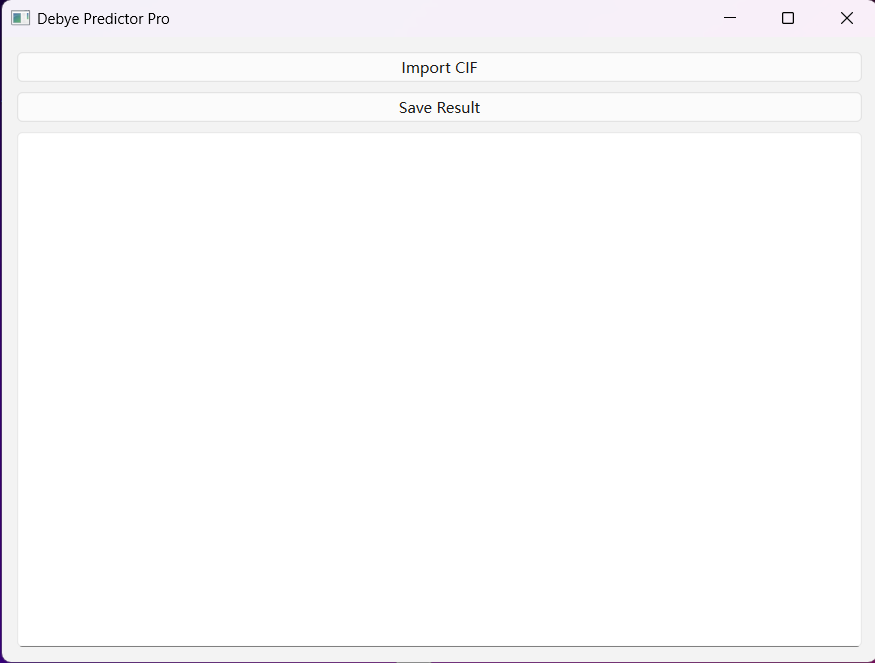

Debye Temperature Predictor
<p align="center">
  <b>A standalone machine-learning application for rapid Debye-temperature prediction from crystallographic information files.</b>
</p>
<p align="center">
  <a href="https://github.com/wwwrssss/Debye-Temperature-Predictor/releases/latest"><b>Download the latest Windows release</b></a>
  \&nbsp;•\&nbsp;
  <a href="https://github.com/wwwrssss/Debye-Temperature-Predictor/tree/main/examples"><b>Example CIF</b></a>
  \&nbsp;•\&nbsp;
  <a href="https://github.com/wwwrssss/Debye-Temperature-Predictor/tree/main/docs"><b>Documentation</b></a>
</p>
---
Overview
Debye Temperature Predictor is a standalone Windows application developed for rapid estimation of the Debye temperature, Θ_D, of inorganic crystalline materials directly from crystallographic information files (`.cif`).
The application was developed as part of a machine-learning-assisted materials-screening workflow in which Debye temperature is used as a descriptor of lattice rigidity. The software is intended to make the trained prediction model easier to use without requiring users to install Python or run source code.
> \*\*Manuscript status:\*\* The associated research article is currently under submission/review. Full bibliographic information will be added after publication.
---
Download
The latest compiled Windows application is available from the GitHub Releases page:
Download Debye Temperature Predictor v1.0.0
Current release:
Version: v1.0.0
Platform: Windows
Input: `.cif`
Output: predicted Debye temperature, Θ_D (K)
No Python installation is required for the standalone Windows executable.
---
Software Interface
<p align="center">
  
</p>
---
Model Performance
The Debye-temperature prediction model used in the associated manuscript achieved the following five-fold cross-validation performance:
Metric	Value
R²	0.968
MAE	28.12 K
RMSE	43.64 K
These values correspond to the model version used in the associated study.
---
Main Features
Direct import of crystallographic information files (`.cif`)
Automatic extraction of composition- and structure-related descriptors
Rapid prediction of Debye temperature
Graphical user interface for non-programming users
Standalone Windows executable
Example CIF file provided for testing
Free for academic and non-commercial research use
---
Quick Start
1. Download
Open the latest release:
https://github.com/wwwrssss/Debye-Temperature-Predictor/releases/latest
Download the Windows executable:
```text
Debye.Temperature.Predictor.v1.0.0.exe
```
2. Launch
Double-click the downloaded executable.
Because this is research software distributed as an unsigned executable, Windows may display a security warning. Please verify that the file was downloaded from this official repository before running it.
3. Import a structure
Select a valid `.cif` file using the file-selection button in the application.
4. Predict
Run the prediction. The application will report:
```text
Predicted Debye temperature: Θ\_D (K)
```
An example CIF file is available in:
```text
examples/example\_BaO.cif
```
---
Intended Use
This application is designed primarily for:
rapid screening of inorganic crystalline materials;
comparison of lattice-rigidity-related trends;
preliminary candidate selection before more computationally intensive calculations;
materials-discovery workflows requiring fast Debye-temperature estimates.
---
Important Limitations
The predicted Debye temperatures are machine-learning estimates intended for screening purposes.
They should not be considered replacements for:
experimental Debye-temperature measurements;
first-principles elastic calculations;
phonon calculations;
other high-accuracy property calculations.
Prediction reliability may decrease for materials that are chemically or structurally far outside the training-data domain.
---
Repository Structure
```text
Debye-Temperature-Predictor/
├── README.md
├── LICENSE
├── CITATION.cff
├── docs/
│   ├── USER\_GUIDE.md
│   ├── MODEL\_INFORMATION.md
│   └── RELEASE\_CHECKLIST.md
├── examples/
│   └── example\_BaO.cif
└── screenshots/
    └── software.png
```
The compiled application is distributed through GitHub Releases rather than stored directly in the main repository.
---
Citation
The associated research article is currently under submission/review.
Until the article is formally published, please cite the software repository if you use the application in academic work:
```text
Debye Temperature Predictor, version 1.0.0.
https://github.com/wwwrssss/Debye-Temperature-Predictor
```
The `CITATION.cff` file will be updated with the final article information after publication.
---
Availability Statement for the Manuscript
A suitable statement for the Experimental Section is:
> Based on the developed Debye-temperature prediction model (R² = 0.968, MAE = 28.12 K, and RMSE = 43.64 K), a standalone application was further developed to enable rapid Θ\_D estimation from crystallographic information files. The application is freely available for academic use at https://github.com/wwwrssss/Debye-Temperature-Predictor.
---
License and Use
The compiled application is provided free of charge for academic and non-commercial research use.
Please see the `LICENSE` file for details.
---
Version
Current release: v1.0.0
For reproducible academic use, please report the software version used in your work.
---
Contact
For questions regarding the software or the associated research, please contact the authors of the accompanying manuscript.
